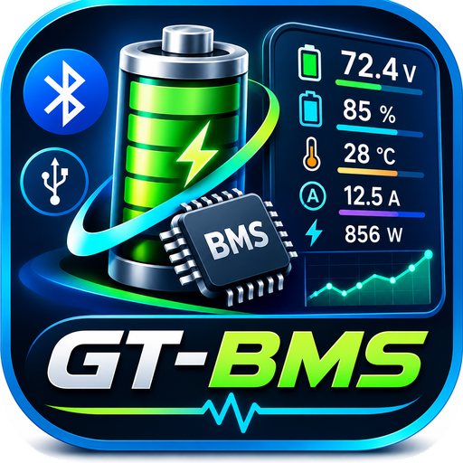

# GT-BMS

**Bluetooth battery-management-system monitor — GNUTUX BMS**

A free Android app (Arabic-first, also in English) that reads smart lithium batteries straight from their
BMS over Bluetooth LE, shows the data clearly, and alarms on full charge or low battery.

[Website](https://salehgnutux.github.io/GT-BMS/) ·
[Latest release](https://github.com/SalehGNUTUX/GT-BMS/releases/latest) ·
[العربية](README.md)

---

## Features

- **Protocol auto-detection**: candidates are ordered by device name, then GATT services, and probed one by
  one until one answers with valid data; the winner is remembered per device so the next connection is instant.
  Manual selection is available too.
- **Supported BMS**:

  | BMS | Status |
  |---|---|
  | Bestway BWBM (0x7F protocol, e.g. BWBM-631M-23S40A) | tested on a real battery |
  | JBD / Xiaoxiang / Overkill (DD A5) | supported |
  | PowerQueen / LiTime / Redodo | supported (from VanAccess) |
  | 123SmartBMS | supported (from VanAccess) |
  | JK-BMS (JK02, 24S & 32S) | experimental — written from community docs |
  | Daly (BLE Modbus protocol) | experimental — written from community docs |

- **Battery screen** with tabs shown according to what the BMS supports:
  - **Live**: SOC gauge, voltage, signed current, power, cell difference, capacity, cycles, every temperature
    probe, charge/discharge MOS, balancing, heating, and localised protection alerts.
  - **Cells**: per-cell mV grid with highest/lowest highlighted, plus a deviation-from-average chart.
  - **Info**: model, versions, serial numbers, BMS clock and protection parameters (read-only).
  - **History**: events stored inside the BMS.
- **Reports** tab:
  - **Charges**, automatically: duration, SOC from/to, Ah and Wh, average and peak current, highest pack and
    cell voltage, largest cell difference, highest temperature, balancing seen, and whether BMS protection ended it.
  - **Trips** with GPS when a vehicle type is chosen (electric bicycle, kick scooter, electric moped, car): distance, moving time,
    top and average speed, energy used, consumption per km, peak current, lowest voltage, largest cell difference
    under load, hard accelerations, and a voltage/current/speed chart.
  - **Discharge** for stationary use (home/solar storage, stationary motor/pump): duration, SOC, energy, average current and power.
    One filter lists trips and discharges; its name follows the battery's use.
  - A trip ends after 2 minutes stopped, 1 minute out of Bluetooth range, or with the "End trip" button.
- **Range estimate and live speed** for vehicles, using nominal voltage, a 10 % reserve and your real consumption, with the calculation explained (ⓘ).
- **Recommendations** that interpret readings using your BMS's own protection limits (not generic numbers): live,
  after each charge and trip, plus a weekly summary with chemistry-appropriate advice.
- **Levels & battery health**: 14-day state-of-charge chart, charge cycles and estimated remaining cycles, last full
  charge and last deep discharge, BMS-reported health and a measured capacity from a full cycle.
- **Recommended voltages** for the charger and the full-charge alarm, computed from the cell protection limit.
- **App language**: follows the system by default; Arabic or English can be chosen in Settings.
- **Battery alarms**: full-charge and low-battery alarms with your own SOC/voltage thresholds, played on the
  alarm stream with a "Stop alarm" notification and anti-spam cooldown, plus a cell-difference alarm (at rest and under load), with a distinct tone per alarm, short (5 s) or continuous.
- **Saved batteries**, fast reconnect to the last one, automatic reconnection.
- **In-app updates** from this repository's releases, resilient to GitHub's request limit.
- **BMS history kept on the phone** with the last download date.
- **Privacy**: reports and tracks stay on the phone. GPS runs only during trips, without Google services.
- **Read-only**: the app never changes BMS settings and sends no control commands.

## Install

Download `GT-BMS-v*-release.apk` from the [releases page](https://github.com/SalehGNUTUX/GT-BMS/releases).
Android 8+ with Bluetooth LE. Then: **Settings → Scan** → tap your battery → **Battery (BMS)**.

## Documentation

- [Bestway BWBM protocol](documentation/PROTOCOL-BWBM.md)
- [Build, release and signing](documentation/BUILD.md)
- [Changelog](CHANGELOG.md)

## Origin and license

GT-BMS is based on the open-source [VanAccess](https://gitlab.com/hc51t/VanAccess) app by hc51t
(PowerQueen, 123SmartBMS, Victron devices, Ai-Tanker switch panel) and, like it, is licensed under
**GNU GPL v3 or later** — see [LICENSE](LICENSE).

The Bestway protocol was documented for interoperability only; this repository contains no code from the
vendor app. Unofficial and not affiliated with any manufacturer. Use at your own risk.
