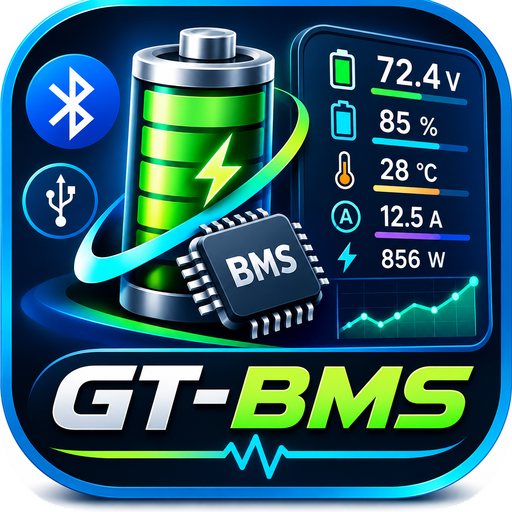

# GT-BMS

**مراقب أنظمة إدارة البطاريات عبر البلوتوث — GNUTUX BMS**

تطبيق أندرويد حرّ، عربيّ الواجهة، يقرأ بيانات بطاريات الليثيوم الذكية مباشرةً من نظام إدارتها (BMS)
ويعرضها بوضوح، مع منبّهات لاكتمال الشحن وانخفاض البطارية.

[الموقع](https://salehgnutux.github.io/GT-BMS/) ·
[تنزيل أحدث إصدار](https://github.com/SalehGNUTUX/GT-BMS/releases/latest) ·
[English](README.en.md)

---

## المزايا

- **تعرّف تلقائي على البروتوكول**: يرتّب البروتوكولات المرشّحة حسب اسم الجهاز ثم خدماته، ويجرّبها واحداً
  تلو الآخر حتى يردّ أحدها ببيانات صحيحة، ثم يحفظه للجهاز فيصبح الاتصال التالي فورياً. ويمكن اختيار البروتوكول يدوياً.
- **الأنظمة المدعومة**:

  | النظام | الحالة |
  |---|---|
  | Bestway BWBM (بروتوكول ‎7F، مثل BWBM-631M-23S40A) | مُختبَر على بطارية حقيقية |
  | JBD / Xiaoxiang / Overkill (‏DD A5) | مدعوم |
  | PowerQueen / LiTime / Redodo | مدعوم (من VanAccess) |
  | 123SmartBMS | مدعوم (من VanAccess) |
  | JK-BMS (‏JK02، ‏24S و32S) | تجريبي — مكتوب من التوثيق المجتمعي |
  | Daly (بروتوكول Modbus عبر البلوتوث) | تجريبي — مكتوب من التوثيق المجتمعي |

- **«مباشر»** شاشة مستقلة بالزر الدائري في وسط العارضة (يومض أثناء الشحن)، و**شاشة البطارية** بتبويبات تظهر حسب ما
  يدعمه النظام، تتنقّل بينها بالسحب الجانبي، ويتذكّر زر «البطارية» آخر تبويب:
  - **مباشر**: نسبة الشحن على شكل بطارية، الجهد، التيار بإشارته، القدرة، فرق الخلايا، السعة، الدورات،
    كل حسّاسات الحرارة، حالة مفاتيح الشحن والتفريغ والموازنة والتسخين، وتنبيهات الحماية بالعربية.
  - **الخلايا**: شبكة بجهد كل خلية بالمللي فولت مع تمييز الأعلى والأدنى، ومخطّط للانحراف عن المتوسط.
  - **المعلومات**: الطراز، الإصدارات، الأرقام التسلسلية، وقت النظام، ومعاملات الحماية (قراءة فقط).
  - **السجل**: الأحداث المخزّنة داخل نظام الإدارة.
- **التقارير** (تبويب «التقارير»):
  - **الشحن** تلقائياً: المدة، والنسبة من/إلى، والطاقة بالأمبير·ساعة والواط·ساعة، ومتوسط وأعلى تيار، وأعلى جهد
    للبطارية وللخلية، وأكبر فرق خلايا، وأعلى حرارة، وهل حدثت موازنة، وهل أنهت حماية النظام الشحن.
  - **الرحلات** بالـGPS عند اختيار نوع مركبة (دراجة هوائية كهربائية، دراجة تروتينيت، دراجة كهربائية، سيارة/عربة): المسافة، وزمن الحركة، وأقصى
    ومتوسط سرعة، والطاقة المستهلكة، والاستهلاك لكل كيلومتر، وأعلى تيار، وأدنى جهد، وأكبر فرق خلايا تحت الحمل،
    ومرات التسارع القوي، ورسم بياني للجهد والتيار والسرعة.
  - **التفريغ** للاستعمال الثابت (تخزين منزلي/شمسي، محرك ثابت/مضخة): المدة، والنسبة، والطاقة، ومتوسط التيار والقدرة.
    مرشّح واحد في التقارير يجمع الرحلات والتفريغ، واسمه يتبع نوع الاستعمال.
  - تنتهي الرحلة تلقائياً بعد دقيقتين من التوقف أو دقيقة من الابتعاد عن البطارية، أو بزر «إنهاء الرحلة».
- **المدى المتوقع والسرعة** للمركبات، بالجهد الاسمي واحتياطي 10٪ واستهلاكك الفعلي، مع شرح الحساب بأرقامك (ⓘ).
- **التوصيات**: تفسير القراءات بحدود الحماية في نظام بطاريتك نفسها (لا بأرقام عامة)، مباشرة وبعد كل شحنة ورحلة،
  مع ملخص أسبوعي ونصيحة تناسب كيمياء البطارية.
- **المستويات وصحة البطارية**: منحنى نسبة الشحن لآخر 14 يوماً، دورات الشحن والمتبقية تقديرياً، آخر شحنة كاملة
  وآخر تفريغ عميق، والصحة كما يعلنها النظام مع سعة مقاسة من دورة كاملة.
- **الجهد المقترح** للشاحن ولتنبيه اكتمال الشحن، محسوباً من حد حماية الخلية.
- **منبّهات البطارية**: تنبيه اكتمال الشحن وتنبيه انخفاض البطارية بحدود من اختيارك (نسبة أو جهد)،
  بصوت المنبّه وإشعار فيه زر إيقاف، مع منع التكرار المزعج، وتنبيه فرق الخلايا (في الراحة وتحت الحمل)، ونغمة مختلفة لكل منبّه، تنبيه قصير (5 ثوانٍ) أو مستمر.
- **البطاريات المحفوظة** واتصال سريع بآخر بطارية، وإعادة اتصال تلقائية.
- **تحديث من داخل التطبيق**: يفحص إصدارات هذا المستودع وينزّل الجديد ويسلّمه لمثبّت النظام.
- **الشاحن والشحن**: يتعرّف على شاحنك من منحنى كل شحنة (التيار، مرحلة الجهد الثابت، ما أنهى الشحن) ويحكم إن كان
  مناسباً لحدود بطاريتك، مع نصائح للشحن.
- **تصاميم «مباشر»**: كلاسيكي، شرطات ملونة، حلقة، مدمج، القيادة (أفقياً مع إبقاء الشاشة مضاءة)، وزر «مباشر» دائري في
  وسط العارضة.
- **ودجت للشاشة الرئيسية** بنفس تصميم البطارية، و**إشعار دائم حيّ** بالنسبة والجهد والتيار والمدى.
- **تصدير** التقارير CSV ومسارات الرحلات GPX، و**تتبع الخلايا عبر الزمن** لاكتشاف الخلية الضعيفة، و**تذكير بشحنة الموازنة**.
- **الخصوصية**: التقارير والمسارات تُحفظ على الهاتف فقط. يُستعمل GPS أثناء الرحلات فقط، دون خدمات جوجل.
- **قراءة فقط**: لا يغيّر التطبيق أي إعداد في نظام الإدارة ولا يرسل له أوامر تحكّم.
- **اختبار السعة الموجّه**: من الفراغ إلى الامتلاء لقياس السعة الحقيقية وصحة البطارية، بإشعار عند كل خطوة.
- **وقت الشحن المتوقع** حتى 80٪ و100٪، و**المدى حسب الحرارة**.
- **خريطة الرحلة** من خرائط **OsmAnd** المحلية داخل التقرير (أو مخطط دونها)، ملوّنة حسب التيار، بتكبير وتنقل ومشاركة.
- **تكلفة الطاقة** لكل شحنة ورحلة وكيلومتر، مع مقارنة اختيارية بالوقود.
- **أسلوب القيادة**: قفزات التيار المفاجئة، «اضغط وأفلت»، الوقت بتيار عالٍ، أكفأ سرعة من رحلاتك، وتكرار قطع الحماية
  أثناء الشحن، مع نصائح القيادة مع بطاريات الليثيوم.
- **عدة بطاريات**: التبديل بينها من رأس الشاشة، وتقارير وحدود ومنبهات ومركبة لكل بطارية، وتعرّف على نوع الخلايا.
- **التقرير اليومي**: مجموع رحلات اليوم من منتصف الليل إلى منتصف الليل، بمساراته وتكلفته، مع إشعار صامت.
- **تقارير شحن صادقة**: سبب التوقف والخلية، والنسبة قبل قفزة العدّاد، وتقدير وقت يتعلم من شاحنك، وتنبيه الخلية المبكر، وإحصائيات.
- **رحلات لا تضيع**: تستمر بالـGPS عند انقطاع البلوتوث، وتُكتشف والهاتف نائم، وتُستأنف بعد توقف مفاجئ.
- **آخر قراءة محفوظة على الهاتف**: تظهر بعد انهيار التطبيق أو إيقافه حتى يعود الاتصال.
- **نسخة احتياطية كاملة** (تقارير ومسارات وإعدادات) لنقل التطبيق إلى هاتف آخر.
- **تقرير الجهاز** في وحدة التشخيص لدعم أنظمة إدارة جديدة (مشاركة أو بلاغ على GitHub).
- **التحديثات**: فحص دوري تلقائي (مفعّل افتراضياً)، وشريط داخل التطبيق يعرض التحديث وتقدّم تنزيله ثم التثبيت.
- واجهة عربية كاملة مع الإنجليزية والفرنسية: تتبع لغة الهاتف افتراضياً، ويمكن اختيار اللغة من الإعدادات.

## التثبيت

نزّل `GT-BMS-v*-release.apk` من [صفحة الإصدارات](https://github.com/SalehGNUTUX/GT-BMS/releases)
وثبّته (يتطلب السماح بتثبيت التطبيقات من مصادر غير معروفة). يتطلّب أندرويد 8 أو أحدث وهاتفاً يدعم Bluetooth LE.

بعد التثبيت: **الإعدادات ← بحث** ← اضغط على بطاريتك ← **بطارية (BMS)**.

## التوثيق

- [بروتوكول Bestway BWBM](documentation/PROTOCOL-BWBM.md) — بنية الإطارات والأوامر وجداول البيانات.
- [البناء والإصدار والتوقيع](documentation/BUILD.md).
- [النشر على F-Droid](documentation/FDROID.md).
- [سجل التغييرات](CHANGELOG.md).

## الأصل والترخيص

GT-BMS مبنيّ على مشروع [VanAccess](https://gitlab.com/hc51t/VanAccess) للمطوّر hc51t مفتوح المصدر
(دعم PowerQueen و123SmartBMS وأجهزة Victron ولوحة مفاتيح Ai-Tanker)، ويُوزَّع مثله برخصة
**GNU GPL v3 أو أحدث** — انظر [LICENSE](LICENSE).

بروتوكول Bestway استُخرج لأغراض التشغيل البيني فقط؛ لا يتضمّن هذا المستودع أي شيفرة من تطبيق الشركة.
التطبيق غير رسمي ولا علاقة له بالشركات المصنّعة. استخدمه على مسؤوليتك.
